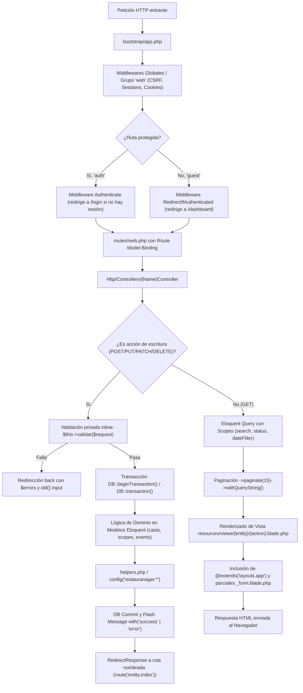

# AGENTS.md — Memoria Arquitectónica y Guía de Desarrollo de RestauManager

Este documento constituye la **memoria técnica exhaustiva**, el **mapa arquitectónico** y el **conjunto de directrices obligatorias** para cualquier agente de IA o desarrollador que trabaje en el repositorio de **RestauManager**. 

---

### 1. Resumen del Stack y Entorno

#### 1.1. Tecnologías y Versiones Detectadas
* **Lenguaje Backend:** PHP `^8.2` (PHP 8.2 o superior requerido).
* **Framework Backend:** Laravel Framework `^12.0` (Laravel 12).
* **Base de Datos:** MySQL / MariaDB (motor InnoDB, cotejamiento `utf8mb4_unicode_ci`, base de datos configurada: `restauranager`).
* **Frontend Web:** 
  * Laravel Blade Engine.
  * **Bootstrap `5.3.3`** y **Bootstrap Icons `1.11.3`** cargados vía CDN (`jsdelivr`) con sistema de diseño personalizado prefijado con `.rm-*`.
  * **Vanilla JavaScript** para interactividad DOM (no se emplean frameworks como Vue, React ni Alpine).
* **Bundler & Build Tools (Skeleton base):** Vite `^7.0.7`, `@tailwindcss/vite` `^4.0.0`, `tailwindcss` `^4.0.0`, `laravel-vite-plugin` `^2.0.0`, `axios` `^1.11.0`, `concurrently` `^9.0.1`.
* **Testing & Calidad de Código:** PHPUnit `^11.5.50`, Mockery `^1.6`, Collision `^8.6`, Laravel Pint `^1.24`, Laravel Pail `^1.2.2`.
* **Configuración Regional:** Idioma `es` (Español), Zona Horaria `America/Bogota`, moneda pesos colombianos (COP).

#### 1.2. Comandos Exactos de Operación

##### Puesta en Marcha Inicial
```bash
# 1. Instalar dependencias de PHP
composer install

# 2. Configurar variables de entorno y generar clave de cifrado
copy .env.example .env
php artisan key:generate

# 3. Crear base de datos en MySQL
mysql -u root -e "CREATE DATABASE restauranager CHARACTER SET utf8mb4 COLLATE utf8mb4_unicode_ci;"

# 4. Ejecutar migraciones
php artisan migrate

# 5. Poblar datos iniciales y datos de prueba (DemoSeeder)
php artisan db:seed

# 6. Instalar dependencias Node (si se van a compilar assets)
npm install
npm run build
```

##### Servidores y Flujo de Desarrollo
```bash
# Levantar servidor de desarrollo Laravel (disponible en http://localhost:8000)
php artisan serve

# O levantar el pipeline completo (servidor web + cola de trabajos + visor de logs pail + vite)
composer run dev

# Compilar assets en modo desarrollo / producción
npm run dev
npm run build
```

##### Gestión de Base de Datos y Semillas
```bash
# Ejecutar migraciones pendientes
php artisan migrate

# Reinicio completo de base de datos desde cero con semillas
php artisan migrate:fresh --seed

# Ejecutar únicamente un seeder específico
php artisan db:seed --class=DatabaseSeeder
```

##### Ejecución de Pruebas y Linter
```bash
# Correr suite de pruebas con limpieza previa de configuración
composer test
# O directamente vía Artisan:
php artisan test

# Formatear código según PSR-12 / estándar Laravel Pint
vendor/bin/pint
```

##### Credenciales Sembradas por Defecto
* **Administrador:** `admin@restauranager.com` | Contraseña: `admin123` (Rol: `admin`)
* **Usuario / Mesero:** `mesero@restauranager.com` | Contraseña: `mesero123` (Rol: `user`)

---

### 2. Mapa de Arquitectura y Estructura de Carpetas

#### 2.1. Mapa de Responsabilidades del Proyecto

```
restaumanager/
├── app/
│   ├── Enums/                 # 11 Backed Enums (PHP string). Fuente única de verdad para estados y tipos.
│   ├── Http/
│   │   └── Controllers/       # 17 Controladores Web que manejan requests, validaciones y respuestas.
│   ├── Models/                # 16 Modelos Eloquent con relaciones, casts, scopes y lógica de dominio.
│   ├── Providers/             # Proveedores de servicios del framework.
│   └── helpers.php            # Funciones globales de negocio (money, pct, badge, next_document_number, etc.).
├── bootstrap/
│   └── app.php                # Configuración de rutas, middlewares y excepciones (Laravel 12 minimalista).
├── config/
│   ├── restauranager.php      # Parámetros de negocio globales (tasas de IVA 19% y cargo de servicio 10%).
│   └── ...                    # Archivos de configuración estándar de Laravel.
├── database/
│   ├── migrations/            # 18 migraciones consolidadas (esquema relacional íntegro).
│   └── seeders/               # DatabaseSeeder (usuarios base) y DemoSeeder (datos de demostración).
├── public/                    # Punto de entrada público (index.php, .htaccess).
├── resources/
│   ├── css/ & js/             # Archivos de entrada Vite y utilidades bootstrap.js con Axios.
│   └── views/                 # 50+ Vistas Blade organizadas en carpetas modulares por entidad.
│       ├── auth/              # Formulario de inicio de sesión.
│       ├── layouts/           # Plantillas maestras: app.blade.php y guest.blade.php.
│       ├── bills/             # Facturación y registro de cobros.
│       ├── customers/         # Gestión de clientes y fidelización.
│       ├── dashboard/         # Métricas, alertas y accesos directos.
│       ├── employees/         # Empleados y sus sub-vistas shifts/ (turnos).
│       ├── inventory/         # Insumos y ajustes de stock.
│       ├── menus/             # Menú dividido en categories/ e items/.
│       ├── orders/            # POS de órdenes, detalle comanda y vista kitchen (cocina).
│       ├── purchases/         # Órdenes de compra y recepción de inventario.
│       ├── reports/           # Reportes analíticos con KPIs y desglose de ventas.
│       ├── reservations/      # Reservas de mesas y validación de aforo.
│       └── tables/            # Catálogo y estado de mesas.
├── routes/
│   ├── web.php                # 93 rutas web protegidas y estructuradas por prefijos semánticos.
│   └── console.php            # Comandos artisan personalizados.
└── tests/
    ├── Feature/               # Pruebas funcionales y de integración HTTP.
    └── Unit/                  # Pruebas unitarias de modelos y helpers.
```

#### 2.2. Flujo Completo de una Petición (Request Lifecycle)



---

### 3. Convenciones de Código Detectadas (Patrones a Imitar)

#### 3.1. Nomenclatura y Estándares
* **Modelos Eloquent:** PascalCase en singular en inglés (`Customer`, `Order`, `InventoryItem`, `RestaurantTable`, `PurchaseOrderItem`).
* **Controladores:** PascalCase con sufijo `Controller` en inglés (`OrderController`, `CustomerController`, `BillsController`, `ReportController`).
* **Enums de PHP:** PascalCase en singular en inglés (`OrderStatus`, `TableStatus`, `PaymentMethod`, `EmployeeRole`).
* **Tablas de Base de Datos:** snake_case en plural en inglés (`restaurant_tables`, `reservations`, `customers`, `bills`, `purchase_orders`), **con una excepción consolidada:** la tabla `inventory` es singular (manejada explícitamente por `InventoryItem` con `protected $table = 'inventory';`).
* **Columnas y Claves Foráneas:** snake_case en inglés (`restaurant_table_id`, `customer_id`, `subtotal`, `is_active`, `received_qty`).
* **Variables internas y métodos privados:** En controladores y vistas Blade se utiliza **español** para variables de negocio y métodos de validación (`$registros`, `$filtros`, `$orden`, `$cliente`, `validar()`, `validarCabecera()`, `crearItems()`).
* **Rutas Web:** Kebab-case en URLs (`/menu-categories`, `/menu-items`, `/adjust-quantity`), con nombres de ruta anidados en snake/kebab: `orders.index`, `menu-items.toggle-available`, `purchases.receive`.

#### 3.2. Estructura de Controladores y Modelos (Ejemplos de Referencia)

##### Ejemplo 1: CRUD Estándar con Scopes y Traducción de Atributos (`app/Http/Controllers/CustomerController.php`)
Los controladores delegan la lógica de consulta a Scopes del modelo y definen un método privado `validar()` que traduce los atributos de validación al español:
```php
public function index(Request $request)
{
    $filtros = $request->only(['q', 'vip']);
    $registros = Customer::query()
        ->search($filtros['q'] ?? null)
        ->vip($filtros['vip'])
        ->orderBy('name')
        ->paginate(15)
        ->withQueryString();

    return view('customers.index', compact('registros', 'filtros'));
}

private function validar(Request $request, ?Customer $cliente = null): array
{
    return $request->validate([
        'name' => ['required', 'string', 'max:255'],
        'email' => ['nullable', 'email', 'max:255', Rule::unique('customers', 'email')->ignore($cliente)],
        'is_vip' => ['nullable', 'boolean'],
    ], [], [
        'name' => 'nombre',
        'email' => 'correo electrónico',
        'is_vip' => 'cliente VIP',
    ]);
}
```

##### Ejemplo 2: Transacción Compleja, Dominio en Modelo y Enums (`app/Http/Controllers/OrderController.php` & `app/Models/Order.php`)
Las mutaciones críticas usan transacciones explícitas, numeración automática en el modelo vía `booted()`, y recalculo de montos encapsulado:
```php
// En Order.php:
protected static function booted(): void
{
    static::creating(function (self $model) {
        if (! $model->order_number) {
            $model->order_number = next_document_number('ORD', 'order_number', 'orders');
        }
    });
}

public function recalculateTotals(): void
{
    $subtotal = (float) $this->items()->sum('subtotal');
    $tax = round($subtotal * (float) config('restauranager.tax_rate', 0.19), 2);
    $this->forceFill([
        'subtotal' => $subtotal,
        'tax' => $tax,
        'total' => $subtotal + $tax,
    ])->save();
}

// En OrderController.php:
DB::beginTransaction();
try {
    $orden = Order::create($data);
    $this->crearItems($orden, $items);
    $orden->recalculateTotals();
    DB::commit();
} catch (\Throwable $e) {
    DB::rollBack();
    return redirect()->back()->with('error', 'No se pudo registrar la orden.')->withInput();
}
```

##### Ejemplo 3: Backed Enums con Labels y Badges (`app/Enums/OrderStatus.php`)
Todos los enums implementan `options(): array`, `label(): string` (texto en español) y `badge(): string` (clases Bootstrap):
```php
namespace App\Enums;

enum OrderStatus: string
{
    case Open = 'open';
    case Preparing = 'preparing';
    case Ready = 'ready';
    case Served = 'served';
    case Cancelled = 'cancelled';

    public static function options(): array { /* [value => label] */ }
    public function label(): string { /* 'Abierta', 'Preparando'... */ }
    public function badge(): string { return match($this) { self::Open => 'bg-info text-dark', self::Served => 'bg-success', ... }; }
}
```

#### 3.3. Manejo de Validaciones, Errores y Respuestas al Usuario
* **Validación en Controlador:** No se utilizan clases `FormRequest` adicionales; la validación se realiza mediante `$request->validate()` o métodos privados `validar()` en el propio controlador.
* **Mensajes de Flash en Sesión:** Se comunican exclusivamente mediante tres claves estandarizadas:
  * `session('success')`: Mensaje de operación exitosa en alerta verde (`alert-success`).
  * `session('error')`: Mensaje de error de negocio o excepción en alerta roja (`alert-danger`).
  * `session('info')`: Mensajes informativos en alerta azul (`alert-info`).
* **Protección de Integridad Referencial:** Antes de borrar registros con relaciones vivas, se valida manualmente y se rechaza con mensaje explicativo:
  * No eliminar mesas si tienen reservas u órdenes activas (`RestaurantTableController::destroy`).
  * No eliminar categorías si contienen platos o bebidas (`MenuCategoryController::destroy`).
  * No eliminar órdenes si ya cuentan con factura emitida (`OrderController::destroy`).
  * No eliminar proveedores si registran órdenes de compra (`SupplierController::destroy`).

#### 3.4. Sistema de Diseño UI y Componentes Base
* **Layouts Base:**
  * `resources/views/layouts/app.blade.php`: Layout para usuarios autenticados. Proporciona la barra lateral colapsable (`#rmSidebar`), topbar con avatar y dropdown de usuario, área principal de contenido (`.rm-content`), visualizador de alertas de sesión y bloque de `@stack('scripts')`.
  * `resources/views/layouts/guest.blade.php`: Layout para invitados, utilizado en el inicio de sesión con tarjeta centrada y fondo en gradiente oscuro.
* **Componentes y Clases CSS Obligatorias (`.rm-*`):**
  * `.rm-card`: Tarjeta estilizada con sombra suave y bordes redondeados (`border-radius: .75rem`).
  * `.rm-card-header`: Encabezado de tarjeta en fondo blanco con tipografía semi-negrita y borde inferior sutil.
  * `.rm-card-body`: Contenedor interno con espaciado consistente.
  * `.rm-stat`, `.rm-stat-value`, `.rm-stat-label`: Tarjetas de estadísticas/KPIs en dashboards.
  * `.rm-empty`: Estado vacío con icono atenuado y mensaje explicativo cuando una tabla o consulta no tiene registros.
  * `.rm-avatar`: Círculo con la inicial del usuario en el color primario de la aplicación.
* **Estructura Modular de Formularios:**
  * Los formularios de creación y edición reutilizan invariablemente un archivo parcial `_form.blade.php` ubicado dentro de la carpeta de la entidad (ej. `resources/views/customers/_form.blade.php`).
  * En la cabecera del parcial se declara: `@php($modelo = $modelo ?? null)` para permitir su uso dual en `create` y `edit`.
* **Helpers Globales de UI:**
  * `{!! badge($modelo->status) !!}`: Genera la etiqueta HTML con el badge y color correspondiente al enum.
  * `{{ money($monto) }}`: Formatea montos en pesos COP sin decimales (ej. `$ 15.000`).
  * `{{ money_exact($monto) }}`: Formatea con 2 decimales para totales exactos.
  * `{{ pct($tasa) }}`: Formatea porcentajes (ej. `19%`).
  * `{{ date_es($fecha) }}` y `{{ time_es($hora) }}`: Renderiza fechas y horas legibles en español.

---

### 4. Estado Actual del Proyecto

#### 4.1. Módulos Completados (100% Funcionales de Punta a Punta)
El backend web y la interfaz administrativa de **RestauManager** cuentan actualmente con **93 rutas web** completamente operativas:

1. **Módulo 1: Autenticación Web (`/login`, `/logout`)**
   * Validación de credenciales con hashing Bcrypt.
   * Bloqueo estricto de usuarios con bandera `active = false`.
   * Regeneración de sesión y rotación de token CSRF.
2. **Módulo 2: Dashboard Principal (`/dashboard`)**
   * KPIs en tiempo real (total inventario, alertas de stock crítico, reservas del día, mesas libres vs. ocupadas, ventas de la jornada).
   * Tablas de reservas próximas y órdenes recientes.
3. **Módulo 3: Inventario (`/inventory`)**
   * CRUD completo de insumos con 9 categorías predefinidas (`InventoryCategory`).
   * Ajuste incremental/decremental de cantidades (`/adjust-quantity`) que impide que el stock sea inferior a cero.
   * Filtro de stock bajo (`quantity <= min_stock`), soft-deletes y estado `active`.
4. **Módulo 4: Reservas (`/reservations`)**
   * CRUD completo de reservas con estados `pending`, `confirmed`, `cancelled`, `completed`.
   * Validación automática de aforo: impide reservar una mesa si su capacidad es menor al número de comensales.
   * Actualización rápida de estado por endpoint PATCH.
5. **Módulo 5: Mesas del Restaurante (`/tables`)**
   * Administración de mesas por capacidad, 6 ubicaciones y 4 estados (`available`, `occupied`, `reserved`, `maintenance`).
   * Protección contra borrado físico si la mesa tiene reservas u órdenes activas.
6. **Módulo 6: Menú · Categorías (`/menu-categories`)**
   * Gestión jerárquica con orden numérico (`sort_order`) y slug.
   * Protección de eliminación si existen platos o bebidas vinculadas.
7. **Módulo 7: Menú · Platos y Bebidas (`/menu-items`)**
   * CRUD completo con precios, tiempo estimado de preparación, ingredientes y categoría.
   * Endpoint de conmutación rápida de disponibilidad (`/toggle-available`).
8. **Módulo 8: Clientes (`/customers`)**
   * Catálogo de clientes con identificación de condición VIP.
   * Historial de últimas 10 órdenes y 10 reservas en vista de detalle.
   * Método de modelo `registerVisit($amount)` para acumulación automática de visitas y consumo histórico.
9. **Módulo 9: Empleados (`/employees`)**
   * Catálogo de colaboradores por roles (`admin`, `manager`, `waiter`, `chef`, `cashier`, `cleaning`).
   * Registro de fecha de ingreso, salario y estado de actividad.
10. **Módulo 10: Turnos y Horarios (`/shifts`)**
    * Asignación semanal por empleado, día de la semana y rango de horas.
    * Cálculo dinámico de duración en horas y minutos mediante helper `shift_duration()`.
11. **Módulo 11: Órdenes / POS y Cocina (`/orders`, `/kitchen`)**
    * Punto de venta interactivo con agregación dinámica de platos mediante Vanilla JS.
    * Numeración automática `ORD-YYMMDD-NNN`.
    * Ocupación automática de la mesa asignada en modo Dine-In.
    * Pantalla de Cocina en vivo (`/kitchen`) con seguimiento del estado item por item (`pending`, `preparing`, `ready`, `served`).
12. **Módulo 12: Facturación (`/bills`)**
    * Facturación ligada a órdenes cerradas con numeración `FAC-YYMMDD-NNN`.
    * Cálculo automático: Subtotal + IVA 19% + Cargo por servicio 10% - Descuento.
    * Soporte de pagos parciales con cálculo de balance en tiempo real.
    * Transición automática a estado `paid` y liberación automática de la mesa asociada al liquidar la totalidad de la cuenta.
13. **Módulo 13: Proveedores (`/suppliers`)**
    * Directorio de proveedores clasificados por categoría de suministro.
    * Historial de órdenes de compra vinculadas y protección contra eliminación.
14. **Módulo 14: Órdenes de Compra (`/purchases`)**
    * Flujo de adquisiciones con numeración `PO-YYMMDD-NNN`.
    * Recepción parcial o total de insumos (`/receive`), actualizando automáticamente el stock en el inventario.
    * Bloqueo de edición y borrado una vez la orden pasa a estado recibida o cancelada.
15. **Módulo 15: Reportes y Analítica (`/reports`)**
    * Filtro dinámico por rango de fechas (por defecto: últimos 30 días).
    * KPIs de facturación, ticket promedio, top 10 platos más vendidos, distribución por métodos de pago y volumen de reservas.

#### 4.2. Módulos Incompletos, Pendientes o Fases Posteriores
De acuerdo con la inspección del repositorio y el documento `REQUERIMIENTOS.txt`:

1. **Módulo 16: Aplicación Móvil en Flutter (`flutter_app/`)**
   * **Estado:** No iniciado. No existe el directorio ni los archivos del proyecto Flutter en el repositorio actual.
2. **Capa de API REST (Laravel Sanctum)**
   * **Estado:** Pendiente. En los requerimientos están especificados 26 endpoints REST (`/api/login`, `/api/inventory`, `/api/orders`, `/api/tables`, etc.) para alimentar la app móvil.
   * **Faltante técnico:** El archivo `routes/api.php` no existe, no está registrado en `bootstrap/app.php`, no se han creado las clases de `app/Http/Resources`, ni se ha añadido el trait `HasApiTokens` al modelo `User`.
3. **Suite de Pruebas Automatizadas del Backend**
   * **Estado:** Incompleta. Solo existen los dos archivos de prueba iniciales de Laravel (`ExampleTest.php` en Unit y Feature). Los 17 tests funcionales descritos en la especificación están pendientes de desarrollo.
4. **Estrategia de Estilos Offline / Producción**
   * **Estado:** Las vistas actuales dependen del CDN de Bootstrap 5.3 y Bootstrap Icons vía internet. Si se requiere empaquetado 100% offline o estricto con Tailwind 4, se requerirá unificar la integración con Vite.

---

### 5. Reglas Inquebrantables para el Agente (Guardrails)

Cualquier agente de IA que opere sobre este código debe obedecer de manera irrestricta las siguientes directrices:

1. **Prohibición de Instalar Dependencias Sin Autorización Explícita:**
   * No ejecutar `composer require` ni `npm install <package>` salvo que el usuario lo solicite explícitamente. Trabajar exclusivamente con las herramientas instaladas (Laravel 12, Bootstrap 5.3, Eloquent, Carbon).
2. **Inmutabilidad de Esquemas Consolidados y Migraciones Base:**
   * Bajo ninguna circunstancia se deben modificar ni borrar las 18 migraciones existentes en `database/migrations/`.
   * Cualquier alteración a la base de datos debe realizarse a través de una **nueva migración** incremental (`add_*_to_*_table` o `modify_*`).
3. **Reutilización Obligatoria de Componentes y Helpers Existentes:**
   * No reinventar funciones para formatear monedas, fechas o porcentajes; utilizar siempre `money()`, `money_exact()`, `pct()`, `date_es()`, `time_es()` y `badge()`.
   * No hardcodear etiquetas o clases CSS de estados; utilizar siempre los métodos de los `Enums` (`label()`, `badge()`, `options()`).
   * No generar formularios duplicados; reutilizar el partial `_form.blade.php` en los CRUDs.
   * Extender siempre de `layouts.app` para vistas internas y utilizar las clases `.rm-card`, `.rm-card-header`, `.rm-stat`, etc.
4. **Coherencia de Idioma y Convenciones Lingüísticas:**
   * **Código de clases y base de datos:** Nombres de clases, modelos, enums, tablas y columnas siempre en **inglés**.
   * **Variables de flujo y métodos privados de controlador:** Mantener el estándar existente en **español** (`$registros`, `$filtros`, `$orden`, `validar()`).
   * **Textos para el usuario:** Comentarios de código, nombres de campos en validación, mensajes flash (`success`, `error`) y toda la interfaz Blade deben estar en **Español (Colombia / Latinoamérica)**.
   * **Precios e importes:** Siempre en pesos colombianos sin decimales en vistas estándar (`money()`), utilizando la tasa de IVA del 19% proveniente de `config('restauranager.tax_rate')`.
5. **No Romper la Lógica de Negocio Establecida:**
   * El stock de inventario jamás puede quedar en valores negativos (`adjustQuantity` utiliza `max(0, $new)`).
   * La recepción de órdenes de compra debe actualizar el stock en inventario y verificar si el total recibido completa la orden.
   * El pago completo de una factura debe marcar automáticamente la factura como `paid` y liberar la mesa vinculada (`TableStatus::Available`).
   * Toda eliminación debe respetar las protecciones de integridad relacional existentes.
